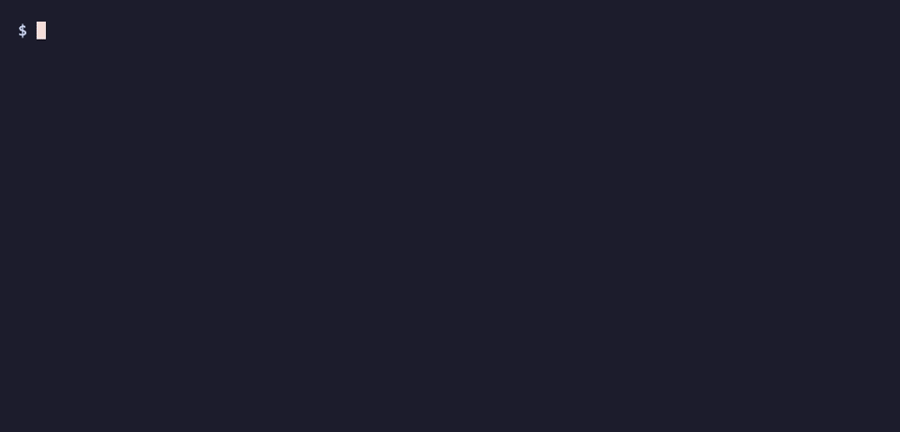

<p align="center">
    <a href="https://www.a11ypulse.com/?utm_source=github&utm_content=audits-logo" target="_blank">
        <picture>
            <source srcset="https://app.a11ypulse.com/images/a11y-pulse-logo-white.png" media="(prefers-color-scheme: dark)" />
            <source srcset="https://app.a11ypulse.com/images/a11y-pulse-logo.png" media="(prefers-color-scheme: light), (prefers-color-scheme: no-preference)" />
            
        </picture>
    </a>
</p>

<p align="center">
    <a href="https://github.com/A11y-Pulse/audits/actions/workflows/ci.yml"></a>
    <a href="https://github.com/A11y-Pulse/audits/actions/workflows/release.yml"></a>
    <a href="https://www.npmjs.com/package/@a11y-pulse/audit-runner"></a>
    <a href="https://www.npmjs.com/package/@a11y-pulse/audit-runner"></a>
    <a href="https://polyformproject.org/licenses/shield/1.0.0/"></a>
</p>

# Automated interaction-driven web accessibility testing

A collection of audits that are designed to complement static analysis tools like axe-core and HTML_CodeSniffer. They work by simulating user interaction through a real web browser, allowing them to test against WCAG success criteria that static analysis tools cannot.

<sup>Made with ❤️ by the [A11y Pulse](https://www.a11ypulse.com/?utm_source=github&utm_content=audits-lead) team in New Zealand.</sup>



## Coverage

| Success criterion | A11y-Pulse/audits | axe-core | pa11y (HTML_CodeSniffer) |
| --- | --- | --- | --- |
| [1.1.1 Non-text Content](https://www.w3.org/WAI/WCAG22/Understanding/non-text-content) (A) | ✅ | 🟡<sup>1</sup> | ➖<sup>2</sup> |
| [1.3.1 Info and Relationships](https://www.w3.org/WAI/WCAG22/Understanding/info-and-relationships) (A) | ✅ | 🟡<sup>6</sup> | ❔<sup>14</sup> |
| [1.4.1 Use of Color](https://www.w3.org/WAI/WCAG22/Understanding/use-of-color) (A) | ✅ | 🟡<sup>3</sup> | ➖<sup>2</sup> |
| [1.4.4 Resize Text](https://www.w3.org/WAI/WCAG22/Understanding/resize-text) (AA) | ✅ | 🟡<sup>7</sup> | ❔<sup>14</sup> |
| [1.4.10 Reflow](https://www.w3.org/WAI/WCAG22/Understanding/reflow) (AA) | ✅ | ❌ | ➖<sup>2</sup> |
| [1.4.11 Non-text Contrast](https://www.w3.org/WAI/WCAG22/Understanding/non-text-contrast) (AA) | ✅<sup>12</sup> | ❌ | ❔<sup>14</sup> |
| [1.4.12 Text Spacing](https://www.w3.org/WAI/WCAG22/Understanding/text-spacing) (AA) | ✅ | 🟡<sup>4</sup> | ➖<sup>2</sup> |
| [2.1.1 Keyboard](https://www.w3.org/WAI/WCAG22/Understanding/keyboard) (A) | ✅ | 🟡<sup>8</sup> | ❔<sup>14</sup> |
| [2.1.2 No Keyboard Trap](https://www.w3.org/WAI/WCAG22/Understanding/no-keyboard-trap) (A) | 🟡<sup>13</sup> | ❌ | ➖<sup>2</sup> |
| [2.2.2 Pause, Stop, Hide](https://www.w3.org/WAI/WCAG22/Understanding/pause-stop-hide) (A) | ✅ | 🟡<sup>9</sup> | ❔<sup>14</sup> |
| [2.4.1 Bypass Blocks](https://www.w3.org/WAI/WCAG22/Understanding/bypass-blocks) (A) | ✅ | 🟡<sup>5</sup> | ➖<sup>2</sup> |
| [2.4.3 Focus Order](https://www.w3.org/WAI/WCAG22/Understanding/focus-order) (A) | 🟡<sup>13</sup> | ❌ | ❔<sup>14</sup> |
| [2.4.4 Link Purpose (In Context)](https://www.w3.org/WAI/WCAG22/Understanding/link-purpose-in-context) (A) | ✅ | 🟡<sup>10</sup> | ❔<sup>14</sup> |
| [2.4.6 Headings and Labels](https://www.w3.org/WAI/WCAG22/Understanding/headings-and-labels) (AA) | ✅ | ❌ | ➖<sup>2</sup> |
| [2.4.7 Focus Visible](https://www.w3.org/WAI/WCAG22/Understanding/focus-visible) (AA) | ✅ | ❌ | ➖<sup>2</sup> |
| [2.4.11 Focus Not Obscured](https://www.w3.org/WAI/WCAG22/Understanding/focus-not-obscured-minimum) (AA) | ✅ | ❌ | ❌ |
| [3.2.1 On Focus](https://www.w3.org/WAI/WCAG22/Understanding/on-focus) (A) | ✅ | ❌ | ➖<sup>2</sup> |
| [3.3.8 Accessible Authentication](https://www.w3.org/WAI/WCAG22/Understanding/accessible-authentication-minimum) (AA) | 🟡<sup>13</sup> | ❌ | ❌ |
| [4.1.2 Name, Role, Value](https://www.w3.org/WAI/WCAG22/Understanding/name-role-value) (A) | ✅ | 🟡<sup>11</sup> | ❔<sup>14</sup> |

<sup>
1. The `image-alt` audit and its relatives only check that a text alternative exists.<br />
2. Manual review only: emits a note asking a human to check the criterion.<br />
3. The `link-in-text-block` audit only checks that links are distinguishable from the surrounding text.<br />
4. The `avoid-inline-spacing` audit only flags inline `!important` spacing declarations.<br />
5. The `bypass` audit only checks that a bypass mechanism exists, not that it works.<br />
6. The audits for this criterion check lists, tables and required ARIA parents and children, not whether tabs and tab panels are paired.<br />
7. The `meta-viewport` audit only checks that the viewport tag does not disable zooming, not what the page looks like once zoomed.<br />
8. The `scrollable-region-focusable`, `frame-focusable-content` and `server-side-image-map` audits only check that scrollable regions and frames can be reached and that no server-side image map is used, not other controls.<br />
9. The `blink` and `marquee` audits only flag those two elements, not carousels or animations.<br />
10. The `link-name` audit only checks that a link has a name, not what the name is.<br />
11. The audits for this criterion check that controls have names and that ARIA attributes are valid, not that a control built from a `div` has a role or that a disclosure's state changes when it is operated.<br />
12. Focus indicators only: the contrast of other controls and graphics is not measured.<br />
13. Reported for human review only: these audits collect the evidence but never fail a page on their own.<br />
14. Not verified for this table.<br />
</sup>

## Quick Start

The [@a11y-pulse/audit-runner package](./packages/audit-runner) is a simple command line tool to run the audits against a single URL:

```bash
npx @a11y-pulse/audit-runner https://example.com/
```

It also serves as an implementation reference for integrating the audits in your own automation pipeline. Individual audits can also be used on their own - see the README in each package for details.

## Packages

| Package | What it checks |
| --- | --- |
| [@a11y-pulse/focus-appearance-audit](./packages/focus-appearance-audit) | [WCAG 2.4.7 Focus Visible](https://www.w3.org/WAI/WCAG22/Understanding/focus-visible): tabs through a page and detects a visible focus indicator. Also flags indicators that rely on colour alone ([WCAG 1.4.1 Use of Color](https://www.w3.org/WAI/WCAG22/Understanding/use-of-color)) and indicators with less than 3:1 contrast ([WCAG 1.4.11 Non-text Contrast](https://www.w3.org/WAI/WCAG22/Understanding/non-text-contrast)) |
| [@a11y-pulse/focus-not-obscured-audit](./packages/focus-not-obscured-audit) | [WCAG 2.4.11 Focus Not Obscured (Minimum)](https://www.w3.org/WAI/WCAG22/Understanding/focus-not-obscured-minimum): tabs through a page and detects focused elements entirely hidden behind other content |
| [@a11y-pulse/context-change-on-focus-audit](./packages/context-change-on-focus-audit) | [WCAG 3.2.1 On Focus](https://www.w3.org/WAI/WCAG22/Understanding/on-focus): tabs through a page and detects focus-triggered context changes (new windows, auto-submits, navigation, focus theft/removal) |
| [@a11y-pulse/keyboard-trap-audit](./packages/keyboard-trap-audit) | [WCAG 2.1.2 No Keyboard Trap](https://www.w3.org/WAI/WCAG22/Understanding/no-keyboard-trap): tabs through a page, detects focus confined to part of it, and tries the standard keyboard exits before reporting a trap |
| [@a11y-pulse/filename-alt-text-audit](./packages/filename-alt-text-audit) | [WCAG 1.1.1 Non-text Content](https://www.w3.org/WAI/WCAG22/Understanding/non-text-content): flags image alt text that is the image's own filename, a camera file name or placeholder text |
| [@a11y-pulse/focus-order-audit](./packages/focus-order-audit) | [WCAG 2.4.3 Focus Order](https://www.w3.org/WAI/WCAG22/Understanding/focus-order): tabs through a page and flags focus that repeatedly jumps a long way against the reading order, for human review |
| [@a11y-pulse/orphaned-tab-roles-audit](./packages/orphaned-tab-roles-audit) | [WCAG 1.3.1 Info and Relationships](https://www.w3.org/WAI/WCAG22/Understanding/info-and-relationships) and [4.1.2 Name, Role, Value](https://www.w3.org/WAI/WCAG22/Understanding/name-role-value): flags tabs with no tab panel, tab panels with no tab, and navigation links given the tab role |
| [@a11y-pulse/suspicious-accessible-name-audit](./packages/suspicious-accessible-name-audit) | [WCAG 2.4.6 Headings and Labels](https://www.w3.org/WAI/WCAG22/Understanding/headings-and-labels), [2.4.4 Link Purpose](https://www.w3.org/WAI/WCAG22/Understanding/link-purpose-in-context) and [1.1.1 Non-text Content](https://www.w3.org/WAI/WCAG22/Understanding/non-text-content): flags accessible names that are code, an unrendered template token or placeholder text |
| [@a11y-pulse/reflow-audit](./packages/reflow-audit) | [WCAG 1.4.10 Reflow](https://www.w3.org/WAI/WCAG22/Understanding/reflow): narrows to 320px and checks for content that requires horizontal scrolling |
| [@a11y-pulse/skip-link-audit](./packages/skip-link-audit) | [WCAG 2.4.1 Bypass Blocks](https://www.w3.org/WAI/WCAG22/Understanding/bypass-blocks.html): verifies that skip links are present and functional |
| [@a11y-pulse/text-spacing-audit](./packages/text-spacing-audit) | [WCAG 1.4.12 Text Spacing](https://www.w3.org/WAI/WCAG22/Understanding/text-spacing): applies extra spacing and detects clipped or overlapping text |
| [@a11y-pulse/resize-text-audit](./packages/resize-text-audit) | [WCAG 1.4.4 Resize Text](https://www.w3.org/WAI/WCAG22/Understanding/resize-text): lays the page out as at 200% zoom and detects text that is cut off or overlaps |
| [@a11y-pulse/unreachable-controls-audit](./packages/unreachable-controls-audit) | [WCAG 2.1.1 Keyboard](https://www.w3.org/WAI/WCAG22/Understanding/keyboard) and [4.1.2 Name, Role, Value](https://www.w3.org/WAI/WCAG22/Understanding/name-role-value): tabs through a page and flags controls that Tab never reaches, and focusable controls with no role |
| [@a11y-pulse/disclosure-operability-audit](./packages/disclosure-operability-audit) | [WCAG 2.1.1 Keyboard](https://www.w3.org/WAI/WCAG22/Understanding/keyboard) and [4.1.2 Name, Role, Value](https://www.w3.org/WAI/WCAG22/Understanding/name-role-value): presses Enter and Space on declared disclosures and checks that they open and say so |
| [@a11y-pulse/moving-content-audit](./packages/moving-content-audit) | [WCAG 2.2.2 Pause, Stop, Hide](https://www.w3.org/WAI/WCAG22/Understanding/pause-stop-hide): watches a page for content that keeps moving and looks for a way to pause it |
| [@a11y-pulse/paste-blocking-audit](./packages/paste-blocking-audit) | [WCAG 3.3.8 Accessible Authentication (Minimum)](https://www.w3.org/WAI/WCAG22/Understanding/accessible-authentication-minimum): flags sign-in fields that stop password managers and pasting from working, for human review |
| [@a11y-pulse/browser-adaptor](./packages/browser-adaptor) | Shared browser adaptor primitives (`BrowserAdaptor`, `PuppeteerAdaptor`) and DOM helpers (`getSelector`, `truncateHtml`) used by audit packages |
| [@a11y-pulse/tab-orchestrator](./packages/tab-orchestrator) | Orchestrator that drives a page once so multiple tab-driven audits can share a single tab loop |
| [@a11y-pulse/audit-runner](./packages/audit-runner) | CLI that runs axe-core and all A11y Pulse audits |

## Licence

The packages in this repository are split into two licence categories:

- **The audit packages are [PolyForm Shield 1.0.0](./LICENSE.md).** This means they are source-available and can be used freely, including commercially and in your own internal monitoring, as long as you are not building something that competes with A11y Pulse.
- **The plumbing packages are [MIT](./packages/browser-adaptor/LICENSE.md).** `browser-adaptor`,
  `tab-orchestrator`, and `audit-runner` can all be used freely with almost no restrictions.

Please read the `LICENSE.md` file for each package to understand the specific terms of use.

## Contributing

Adaptors, new criteria and accuracy fixes are all welcome. See
[CONTRIBUTING.md](./CONTRIBUTING.md) for Changesets and pull-request expectations, and the
[open issues](https://github.com/A11y-Pulse/audits/issues) for work that is ready to pick up.

Requires Node.js `>=22`.

```bash
git clone https://github.com/A11y-Pulse/audits.git
cd audits
npm install
npm test                 # typecheck + unit tests
npm run test:integration # real Chromium via Puppeteer
npm run lint
```

## About A11y Pulse

[A11y Pulse](https://www.a11ypulse.com/?utm_source=github&utm_content=audits-about) is a web
accessibility monitoring platform. It scans websites for accessibility issues using real web
browsers, making it easier to reach WCAG compliance and maintain accessibility over time. A11y
Pulse combines these audits with other open-source accessibility testing frameworks to provide more
coverage than most other tools.
