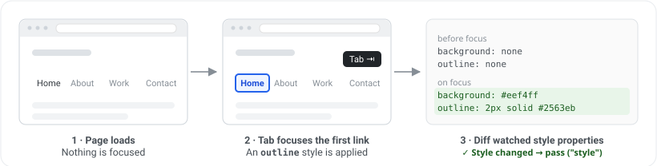

# @a11y-pulse/focus-appearance-audit

[](https://www.npmjs.com/package/@a11y-pulse/focus-appearance-audit)
[](https://github.com/A11y-Pulse/audits/actions/workflows/ci.yml)
[](./LICENSE.md)

An accessibility audit that aims to verify compliance with [**WCAG 2.0: 2.4.7 Focus Visible**](https://www.w3.org/WAI/WCAG20/Understanding/focus-visible). It tabs through a page's focusable elements and detects whether each one shows a visible focus indicator, flags indicators that rely on a change of text colour alone ([WCAG 2.0: 1.4.1 Use of Color](#colour-only-focus-indicators)), and measures the contrast of the indicators it finds ([WCAG 2.1: 1.4.11 Non-text Contrast](#focus-indicator-contrast)). It is built to be framework-agnostic and can be used in any environment that allows you to programmatically focus elements and read their computed styles, such as Puppeteer, Playwright, or Selenium.

This audit was developed by [A11y Pulse](https://www.a11ypulse.com/) for its accessibility monitoring service. It is released as source-available under the [PolyForm Shield License 1.0.0](#license).

## Install

```bash
npm install @a11y-pulse/focus-appearance-audit @a11y-pulse/tab-orchestrator @a11y-pulse/browser-adaptor puppeteer
```

`@a11y-pulse/tab-orchestrator` drives the page (tabbing, markers, screenshots), and [`@a11y-pulse/browser-adaptor`](../browser-adaptor) ships the bundled [Puppeteer and Playwright adaptors](#adaptors); `puppeteer` and `playwright-core` are optional peers of that package, each only required if you use the matching adaptor. Other frameworks can supply their own adaptor without installing either.

## Quickstart

```js
import { runFocusAppearanceAudit } from "@a11y-pulse/focus-appearance-audit";
import { PuppeteerAdaptor } from "@a11y-pulse/browser-adaptor/puppeteer";
import puppeteer from "puppeteer";

const browser = await puppeteer.launch();
const page = await browser.newPage();
await page.goto("https://who.likesdogs.nz/");

const result = await runFocusAppearanceAudit(new PuppeteerAdaptor(page), {
  elementLimit: 20,
});

console.log(result.summary);
// { checked: 2, passed: 1, failed: 1, reachedLimit: false, reachedFailedElementLimit: false, timedOut: false }

console.log(result.elements);
// [
//   {
//     selector: 'html>body>button',
//     html: '<button>',
//     tabIndex: 1,
//     passed: true,
//     detectionMethod: 'style'
//   },
//   {
//     selector: 'html>body>section.wrap>article.pb-3>ul>li>a',
//     html: '<a href="https://github.com/wildlyinaccurate/second">',
//     tabIndex: 2,
//     passed: false,
//     detectionMethod: null
//   },
// ]

await browser.close();
```

See [`examples/puppeteer`](./examples/puppeteer) for a complete, runnable example.

## Shared tab session

`runFocusAppearanceAudit` is a convenience wrapper: it builds a private `@a11y-pulse/tab-orchestrator` session, attaches one consumer, runs it, and hands back that consumer's result. If you're running more than one tab-driven audit against the same page, drive a single shared orchestrator instead so the page is only tabbed through once. Use `createFocusAppearanceAudit` to get a `TabConsumer` you can `attach()` yourself:

```ts
import { createTabOrchestrator } from "@a11y-pulse/tab-orchestrator";
import { createFocusAppearanceAudit } from "@a11y-pulse/focus-appearance-audit";
import { PuppeteerAdaptor } from "@a11y-pulse/browser-adaptor/puppeteer";

const orchestrator = createTabOrchestrator(new PuppeteerAdaptor(page));

const focus = createFocusAppearanceAudit({ elementLimit: 50 });
orchestrator.attach(focus);

await orchestrator.run();

console.log(focus.result);
```

`focus.result` is only complete once `focus` has disconnected (by hitting one of its own limits) or the session has ended. Reading it before then is undefined. See [`@a11y-pulse/tab-orchestrator`](../tab-orchestrator) for the full session lifecycle and capability model.

## Browser support

| Adaptor | Browser | Supported |
| --- | --- | --- |
| Puppeteer | Chrome | Yes |
| Playwright | Chromium | Yes |
| Playwright | WebKit | **No.** WebKit does not move focus to links when Tab is pressed, so the audit only reaches a subset of the page. |
| Playwright | Firefox | **Partial.** Elements inside a closed shadow root get no detection, where Chromium reports a pixel diff. Everything else matches. |

Verified by this repo's integration suites, which run every audit against each of these engines. Unsupported and partial cases are skipped there with the reason printed alongside them.

## Options

The following options can be passed to `runFocusAppearanceAudit` as `FocusAppearanceOptions`:

| Option                    | Type      | Default             | Description                                                                                                                      |
| ------------------------- | --------- | ------------------- | ---------------------------------------------------------------------------------------------------------------------------------- |
| `elementLimit`            | `number`  | `1024`               | Max focusable elements to tab through.                                                                                           |
| `baselineElementLimit`    | `number`  | `elementLimit * 2`   | How many focusable elements to snapshot baseline styles for up front. Not all focusable elements are tabbable (e.g. elements inside menus or hidden containers), so this acts as a floor: the effective baseline budget is `max(elementLimit, baselineElementLimit)`. |
| `screenshotSettleDelay`   | `number`  | `33`                 | How long to wait (in ms) after each Tab for focus styles/transitions to settle.                                                  |
| `screenshotClipBuffer`    | `number`  | `10`                 | Padding (in px) around the element box for the pixel-diff screenshot.                                                            |
| `screenshotDiffThreshold` | `number`  | `4`                  | Number of pixels that must differ to consider an indicator present. Floored at `1`.                                              |
| `skipStyleCheck`          | `boolean` | `false`              | Skip the computed-style stage and run a pixel diff for every element. Much slower, but may reduce false positives in rare cases. |
| `screenshotLimit`         | `number`  | `50`                 | How many elements keep their focused and unfocused screenshots as evidence (failures, elements needing review and low-contrast colour-only changes together). Every element is still checked; past the limit only the screenshots are dropped and `summary.reachedScreenshotLimit` is set. |
| `failedElementLimit`      | `number`  | `0` (never)          | Finish the audit early once this many elements have failed, leaving the rest unchecked. Useful as a fail-fast signal when you only need to know a page has focus problems, not their full extent. |
| `timeout`                 | `number`  | `0` (no timeout)     | Limit how long (in ms) the audit runs before returning the results it has gathered so far.                                       |

## Result shape

`runFocusAppearanceAudit` resolves to a `FocusAppearanceResult`:

```ts
type FocusAppearanceResult = {
  /** Every focusable element that was checked, in tab order. */
  elements: Array<{
    selector: string;
    html: string;
    tabIndex: number;
    /** Read together with `needsReview`. */
    passed: boolean;
    detectionMethod: "style" | "pixel-diff" | "caret" | null;
    /**
     * Present when a person should look at the element: it is neither a clear pass nor a clear
     * failure. `caret` comes with `passed: true`, the others with `passed: false`.
     */
    needsReview?: "caret" | "obstructed" | "shared-indicator" | "animating";
    /** For `detectionMethod: "style"`: what changed, e.g. `["outline-style", "::after background-color"]`. */
    changedProperties?: string[];
    /** Present when the style change was on an ancestor (a `:focus-within` wrapper) or a label. */
    indicatorOn?: { kind: "ancestor" | "label"; html: string };
    /** Present when the element draws nothing itself, so its label or parent was compared instead. */
    measuredOn?: "label" | "parent";
    /** Present when no indicator was detected, for the first `screenshotLimit` such elements. */
    failureEvidence?: {
      /** PNGs of the element (or what was measured in its place) with and without focus. */
      focusedScreenshot: Uint8Array;
      unfocusedScreenshot: Uint8Array;
      /** The painted focus-relevant styles of the element and its `::before`/`::after`, with and without focus. */
      focusedStyles: StyleSnapshot;
      unfocusedStyles: StyleSnapshot;
    };
    /** Present when the only painted change on focus is one colour. */
    colorOnly?: {
      property: "color" | "border-color" | "outline-color" | "background-color";
      unfocusedColor: string;
      focusedColor: string;
      /** Null when either colour is translucent or not in `rgb()` notation. */
      contrastRatio: number | null;
      /** The background the colours are seen against, when it could be told. */
      backgroundColor?: string;
      /** PNGs of the element focused and unfocused, when under 3:1 or null. */
      evidence?: { focusedScreenshot: Uint8Array; unfocusedScreenshot: Uint8Array };
    };
    /** Present when the detected indicator is one whose contrast can be measured. Never changes `passed`. */
    indicatorContrast?: {
      /** Against the colour next to the indicator. Null when it could not be determined; `reason` says why. */
      ratio: number | null;
      /** Against the same part without focus, where known. For information: 1.4.11 does not ask for it. */
      stateChangeRatio?: number;
      /** From computed styles, or from the pixels that differ between the two screenshots. */
      method: "style" | "pixels";
      /** The part that was measured, for `method: "style"`. */
      property?: "outline" | "border" | "box-shadow" | "background-color";
      indicatorColor?: string;
      adjacentColor?: string;
      /** What `adjacentColor` is. */
      comparedAgainst?: "surroundings" | "own-background" | "adjacent-pixels";
      reason?:
        | "translucent"
        | "background-image"
        | "background-unresolved"
        | "too-small"
        | "noisy"
        | "transitioning";
      /** PNGs of the element focused and unfocused, when under 3:1. */
      evidence?: { focusedScreenshot: Uint8Array; unfocusedScreenshot: Uint8Array };
    };
  }>;
  summary: {
    checked: number;
    /** Clear passes: elements that need review are counted in neither `passed` nor `failed`. */
    passed: number;
    failed: number;
    needsReview: number;
    /** Elements whose indicator was measured at under 3:1, less those a measured `colorOnly` covers. */
    lowContrastIndicators: number;
    /** True if `elementLimit` was hit before tabbing finished. */
    reachedLimit: boolean;
    /** True if elements past `screenshotLimit` were recorded without their screenshots. */
    reachedScreenshotLimit: boolean;
    /** True if the audit stopped early after hitting `failedElementLimit`. */
    reachedFailedElementLimit: boolean;
    /** True if the audit returned early because `timeout` elapsed. */
    timedOut: boolean;
  };
};
```

`failedElementLimit` counts clear failures only.

## Detection methods

Focus appearance detection runs in either one or two stages. The first stage is a fast and memory efficient comparison of computed styles. If no style changes are detected, a second stage captures screenshots of the focused element and compares them pixel by pixel. The second stage is more expensive but can detect focus appearance that does not show in computed styles.

### Stage 0: Preparation

At the beginning of the audit, a snapshot of each focusable element's computed styles is taken. This snapshot contains only [focus-relevant properties](./src/focus-style.ts) and the elements' `::before` & `::after` pseudo-elements. The audit then begins a loop of tabbing through each focusable element and running it through the next two stages.

### Stage 1: computed style comparison



Once an element is focused, its computed styles are captured again and compared to the baseline. If any painted property has changed, the element passes with `detectionMethod: "style"` and `changedProperties` lists what changed; if not, it moves to Stage 2. This stage is very fast.

A change only counts when it paints something:

- An outline, border or box-shadow drawn in a fully transparent colour is ignored. `outline: 2px solid transparent` is a common way to give Windows High Contrast users an indicator, and shows nothing to anyone else.
- A `::before` or `::after` that generates no content is ignored.
- An element that draws nothing itself skips this stage altogether: one that is fully transparent, clipped down to a pixel, or positioned off the page. That is how the real `<input>` of a custom checkbox, radio or switch is usually hidden, and the browser's default outline on it is seen by nobody. See [Hidden inputs](#hidden-inputs).

### Stage 2: pixel-diff fallback


Since focus appearance can be achieved without modifying style properties (a `filter`, an animated background), a more expensive pixel-diff fallback is used. In this stage, a clipped screenshot is taken of the element in both its focused and unfocused states. The two images are compared pixel by pixel, and if they differ beyond a certain threshold, the element passes with `detectionMethod: "pixel-diff"`.

A focus style that fades in is only part-way there when focus has just moved. Before each screenshot the audit waits, for up to half a second, for CSS transitions on the element, its labels and its nearest ancestors to finish.

If the screenshots match, the styles of the element's three nearest ancestors and of its labels are compared with and without focus before the element is failed. A search box whose wrapper is styled with `:focus-within`, or a label styled from its input's focus, draws the indicator outside the element's own screenshot; such an element passes with `detectionMethod: "style"` and `indicatorOn` saying where the change was found. (`skipStyleCheck` turns this off too.)

A change on an ancestor or label only identifies the focused element when that ancestor or label is the element's alone:

- **Shared with other tab stops.** A `:focus-within` highlight on an input group or toolbar lights up for whichever control inside it has focus, so it shows that focus is in the group and not where. An element whose only change is on such a container is reported with `needsReview: "shared-indicator"` and `passed: false`. This holds even when the screenshots differ, because the container's highlight reaches into every one of its controls' screenshots. (The radio buttons of one group are a single tab stop and do not make their container shared.)
- **Animating.** A container with a CSS animation running (a pulsing call-to-action, a skeleton shimmer) looks different from one moment to the next whether or not focus moved, so neither its styles nor the screenshots can show an indicator, or the lack of one. An element with no change of its own inside such a container is reported with `needsReview: "animating"` and `passed: false`. Transitions do not count: they are waited for.

### Hidden inputs

When the focused element draws nothing itself, the screenshots are taken of what stands in for it: its `<label>` if it has a visible one, or else its nearest visible ancestor. `measuredOn` says which. A custom checkbox passes when focusing the hidden input changes how that label or wrapper looks (`input:focus-visible + .box { outline: ... }`), and fails when nothing visible changes.

The indicator of a hidden input is as often on a sibling of the input (the box of a custom checkbox, the track of a switch) as on its label, and the label may sit elsewhere in the row. So when a label is used, the screenshots also take in the input's nearest visible ancestor, as one region reaching from one to the other, unless that ancestor is a whole page region (larger than 250,000 square CSS pixels).

### Text fields and the caret

A focused text field shows a blinking text caret. The audit hides the caret while it takes its screenshots, on every browser, so that the caret cannot stand in for a focus indicator on one engine and not on another. A text field that shows nothing else on focus is reported with `detectionMethod: "caret"`, `passed: true` and `needsReview: "caret"`: WCAG 2.4.7 arguably accepts the caret as a focus indicator, but it is easy to miss, so a person should decide. A field whose caret is itself invisible (`caret-color: transparent`) or that shows no caret (`readonly`) fails.

### Elements that stay covered

Before the screenshots are taken, the element is scrolled to the middle of the viewport if anything covers it. An element that cannot be scrolled clear (the last link of a page sitting under a fixed cookie banner) would be photographed as the banner, twice. If its screenshots match, it is reported with `needsReview: "obstructed"` and `passed: false`, with the screenshots as evidence, instead of as a failure. Whether such an element is hidden when focused is a question for [`@a11y-pulse/focus-not-obscured-audit`](../focus-not-obscured-audit).

### What the runner reports

[`@a11y-pulse/audit-runner`](../audit-runner) reports clear failures as `violations` of `focus-appearance`, and every kind of `needsReview` as `incomplete`.

## Colour-only focus indicators

When the computed-style comparison finds that one colour is the only painted change on focus, the element passes 2.4.7 but also gets a `colorOnly` entry with both colours and the contrast ratio between them. The colour can be the text (`color`), an existing border (`border-color`), an existing outline (`outline-color`) or the background (`background-color`); `property` says which. [WCAG 1.4.1 Use of Color](https://www.w3.org/WAI/WCAG22/Understanding/use-of-color) treats colours whose relative luminance differs by at least 3:1 as distinguishable by lightness, so only a change under 3:1 relies on colour alone.

- An underline drawn in the text colour changes with it and still counts as colour only. An underline, outline or any other indicator that appears on focus does not.
- `::before` and `::after` content may change colour with the text. Any other change to it does not count as colour only.
- A border or outline that appears on focus changes its width or style as well, so it is not colour only. For a border, each changed edge is measured and the edge that changes most is the one reported.
- `backgroundColor` is what the two colours are seen against: the element's own background colour if it has one, or else (when screenshots are captured) the nearest opaque background behind it. It is left out when it cannot be told, for example behind a background image.
- `contrastRatio` is `null` when either colour is translucent (its appearance depends on the background) or authored in a colour space other than sRGB. The one exception is a background that is fully see-through in one state (a highlight that appears on focus): it shows the colour behind the element, so that colour stands in for it when it is known, and is given as `backgroundColor`.
- When the ratio is under 3:1 or `null`, `evidence` holds screenshots of the element focused and unfocused, so a reviewer can compare the two colours. This costs the same blur and refocus as the pixel-diff fallback.

[`@a11y-pulse/audit-runner`](../audit-runner) reports these as `focus-color-only`: under 3:1 in `violations`, `null` in `incomplete`, and 3:1 or more in `passes`. The screenshots are attached as `focus-color-only-evidence`.

## Focus indicator contrast

An indicator can exist and still be too faint to see. [WCAG 1.4.11 Non-text Contrast](https://www.w3.org/WAI/WCAG22/Understanding/non-text-contrast) asks for a contrast ratio of at least 3:1 between the visual information that identifies a state, focus included, and the colours next to it. When the audit detects an indicator of a kind it can measure, the element gets an `indicatorContrast` entry, and `summary.lowContrastIndicators` counts those under `MIN_INDICATOR_CONTRAST` (3). This is separate from 2.4.7: a faint indicator still has `passed: true`.

Nothing extra is done to the page for this. The colours come from the styles and screenshots the audit already has; the one added cost is a pair of screenshots as `evidence` for each indicator that measures under 3:1 (within `screenshotLimit`).

1.4.11 is about the indicator against the colours next to it. It is not about how much the element changed from its unfocused state: a grey border that turns blue on a white page has all the contrast the criterion asks for (blue against white), however close the blue is to the grey it replaced. How much one colour moved is what [`colorOnly`](#colour-only-focus-indicators) judges, and only when that colour is the whole indicator. Where the unfocused colour of the measured part is known, the contrast between the two states is given as `stateChangeRatio`, for information; it never decides a result.

Which colours count as next to the indicator depends on where it is drawn:

- **An outline or box-shadow outside the element** (`method: "style"`) is compared with the first opaque background colour behind the element (`comparedAgainst: "surroundings"`).
- **An inset shadow, or an outline pulled inside the element by a negative `outline-offset`**, is compared with the element's own fill (`"own-background"`). An outline that straddles the edge has both neighbours.
- **A border** lies between the element's fill and its surroundings, and is compared with both.
- **A background fill that appears or changes** is compared with the surroundings.
- **An indicator found in the screenshots** (`method: "pixels"`), such as the highlighted label of a custom checkbox, is measured from the pixels that changed: the colour most of them took on focus, against the unchanged pixels next to them in the focused screenshot (`"adjacent-pixels"`). When the indicator was drawn on top of a colour that still surrounds it (a highlight appearing on the page background, with text inside it), that colour is the one it is compared with.
- Where an indicator has two neighbours, standing out from one of them is enough, and the higher ratio is the one reported. When several parts change, the strongest one counts.
- **Text colour is never measured.** It is not an indicator part under 1.4.11.

The background behind an element is read from its ancestors, which is only right when the element is painted on them. For an element that is positioned out of the flow (`absolute`, `fixed` or `sticky`), or that sits inside such an ancestor with nothing opaque in between, it is not known from styles: a link placed over a hero image is painted over a sibling. There, and over a background image or gradient, the audit takes the screenshots it would otherwise skip and measures from the pixels.

The ratio is `null`, with a `reason`, wherever the answer would be a guess:

- `translucent`: the indicator's colour is translucent or in a colour space other than sRGB, or the shadow is a soft glow with no spread.
- `background-image`, `background-unresolved`: an image, gradient or translucent colour is what the indicator is seen against, or the element is positioned over other content, and the screenshots did not settle it either.
- `too-small`, `noisy`: too few pixels changed, or the changed area or what is next to it has no single dominant colour (it sits on a busy photograph, or the change is a blur).
- `transitioning`: a CSS transition or animation was running on the element, its labels or its nearest ancestors when its styles were read, and the indicator measured under 3:1 or could not be read from the screenshots, so the colours were part-way values. An indicator already at 3:1 part-way through is reported as measured.

Some indicators are not measured at all and get no `indicatorContrast`:

- The browser's default focus ring (`outline-style: auto`), which the browser draws in two tones and which 1.4.11 does not ask authors to fix. This holds however the indicator was found, from styles or from screenshots. A weak border or background change that comes with the default ring is not reported either.
- Underlines, text colour, font weight and `::before`/`::after` changes. If one of these changes alongside a weak outline or border, the element is not reported, because the part that was not measured may be what carries the indicator. (A text colour change on its own is covered by [`colorOnly`](#colour-only-focus-indicators).)
- A wrapper or label styled from the element's focus (`indicatorOn`) is measured from the screenshots, since what is behind it is not read.

Known limitations:

- The surroundings are taken to be one flat colour: the first opaque background behind the element. An outline that straddles two backgrounds is only compared with that one.
- A border or straddling outline passes if it stands out from either neighbour. A white border on a dark button on a white page passes on the strength of the dark fill, though from outside it only makes the button look a little smaller.
- An outline drawn at the element's edge (offset 0 or more) is compared with the surroundings only, not with the element's fill.
- A link's text that changes colour, read from screenshots (`skipStyleCheck`, or an element rendered after the page's styles were first read), cannot be told from any other changed pixels and is measured against the page behind it.
- Thickness is not considered. 1.4.11 has no minimum size, so a one-pixel outline at 3:1 passes.

[`@a11y-pulse/audit-runner`](../audit-runner) reports these as `focus-indicator-contrast`: under 3:1 in `violations`, `null` in `incomplete`, and 3:1 or more in `passes`. An element whose only focus change is one colour is judged on that change by `focus-color-only` and left out here, so it is not reported twice. That applies only when `colorOnly.contrastRatio` was measured: if it is `null`, the element is reported here, so a contrast that was measured is never dropped. `summary.lowContrastIndicators` counts exactly the elements the runner reports as violations (`hasLowContrastIndicator` is the shared test).

## Accuracy

This audit is a heuristic and can be wrong in both directions. See [docs/accuracy.md](./docs/accuracy.md) for the known false positives, false negatives, and intentional failures.

## WCAG 2.0 2.4.7 (Focus Visible) vs WCAG 2.2 2.4.13 (Focus Appearance)

Both success criteria concern the keyboard focus indicator, but they set very different bars. [2.4.7 Focus Visible](https://www.w3.org/WAI/WCAG20/Understanding/focus-visible) is a Level AA criterion from WCAG 2.0 and is purely existential: when an element receives keyboard focus, some visible focus indicator must appear. It says nothing about how large or how visible that indicator has to be, so even a faint one-pixel outline satisfies it.

[2.4.13 Focus Appearance](https://www.w3.org/WAI/WCAG22/Understanding/focus-appearance) is a Level AAA criterion added in WCAG 2.2 that closes that gap. On top of requiring an indicator, it sets a minimum size (at least the area of a 2 CSS pixel thick perimeter of the component) and a minimum contrast (a ratio of at least 3:1 between the focused and unfocused states of the same pixels).

At the time of writing this audit only checks for 2.4.7. Support for 2.4.13 will be added in a future release.

## Adaptors

The audit itself is framework-agnostic: it drives a page through an **adaptor**, a small interface of primitives (evaluate JS in the page, press Tab, take a clipped screenshot, etc.) that the audit calls without knowing which browser automation library is behind it.

The `BrowserAdaptor` interface itself lives in [`@a11y-pulse/browser-adaptor`](../browser-adaptor), which also ships the bundled `PuppeteerAdaptor` and `PlaywrightAdaptor`. This package re-exports the type (aliased here as `FocusAppearanceAuditAdaptor`) so `runFocusAppearanceAudit`'s argument type is available without a separate import. Other environments (Selenium, WebDriver) can be supported by implementing the same interface.

Use [`@a11y-pulse/browser-adaptor`'s `src/adaptors/puppeteer.ts`](../browser-adaptor/src/adaptors/puppeteer.ts) as a reference implementation.

## Limitations

- **Focus emulation.** Accurate `:focus`/`document.hasFocus()` reporting for a backgrounded page relies on focus emulation. The Puppeteer adaptor enables it over CDP; Playwright enables its own for every page it creates, on all three engines. An adaptor that offers neither will see the page lose focus mid-audit, which ends the session as `lostFocus` rather than producing failures.
- **Tab order only.** The audit tabs through elements in native tab order. It does not yet exercise arrow-key composite widgets (menus, comboboxes, toolbars, etc.) where focus moves via `aria-activedescendant` or roving `tabindex` instead of native Tab.
- **Heuristic accuracy.** Detection is heuristic and can produce false positives and false negatives. See [Accuracy](#accuracy) and [docs/accuracy.md](./docs/accuracy.md) for known cases.

## Known false positives

Cases where the audit reports a problem that is not one. Each says which bucket it lands in: `incomplete` asks for a human to check, `violations` claims a failure.

[docs/accuracy.md](./docs/accuracy.md) covers these in more depth under "False negatives", where the negative is an accessible indicator judged missing.

- **Indicators drawn outside the element** (`violations`). The style comparison watches the focused element, its three nearest ancestors and its labels, and the pixel diff only captures the element's box plus a small buffer, so an indicator drawn elsewhere (the highlighted option of an `aria-activedescendant` listbox, a sibling styled with `input:focus + .hint`, a remote "you are here" marker) is not seen.
- **Text fields whose focus is clear from the caret alone** (`incomplete`). These are sent for review, not failed. See [Text fields and the caret](#text-fields-and-the-caret).
- **Hidden inputs whose indicator is far from both the label and the input** (`violations`). For an input that draws nothing itself, its label and its nearest visible ancestor (when that is not a whole page region) are compared, plus a small buffer. An indicator drawn somewhere else again is not seen.
- **Controls in a container that highlights for all of them, or that is animating** (`incomplete`). An element whose only focus change is a `:focus-within` style on a container holding other tab stops, or that sits in a container with a CSS animation running, is sent for review, even if it has an indicator of its own that the watched styles do not cover (a `filter`, say). See [Stage 2](#stage-2-pixel-diff-fallback).
- **Elements that disappear when they lose focus** (`violations`, or a pass, arbitrarily). Links inside a menu that opens on focus are hidden again when the audit blurs them to take the unfocused screenshot, so that screenshot is of an empty box at the top-left of the page. The comparison is then against unrelated content and the result does not reflect the element's indicator.
- **Colour changes paired with an indicator outside the watched properties** (`violations` under `focus-color-only`). A focus style that changes the text colour and also adds a `filter`, `transform` or similar is still treated as colour only, because only the [focus-relevant properties](../tab-orchestrator/src/focus-style.ts) are compared.
- **Indicators that only move the element** (`violations`, by design). The pixel diff lines the two screenshots up on the element's position, so a focus style that only shifts it (a `translate` or `margin`) shows no difference and is not counted as an indicator.

## Releasing

Releases are managed in the [A11y-Pulse/audits](https://github.com/A11y-Pulse/audits) monorepo with [Changesets](https://github.com/changesets/changesets). Publishing uses [npm trusted publishing](https://docs.npmjs.com/trusted-publishers/) (OIDC). There is no long-lived `NPM_TOKEN`.

### Ship a change

1. Open a PR against `main` that includes a changeset (`npx changeset`) naming `@a11y-pulse/focus-appearance-audit`.
2. After merge, the Release workflow opens a Version PR. Merging that PR publishes this package to npm and tags `@a11y-pulse/focus-appearance-audit@<version>`.

Trusted Publisher on npm must stay configured for:

| Field | Value |
| --- | --- |
| Organization or user | `A11y-Pulse` |
| Repository | `audits` |
| Workflow filename | `release.yml` |

### Consumers (e.g. the A11y Pulse runner)

Bumping the published version in downstream apps is a separate change. Update the dependency range / lockfile there after the npm release lands.

## License

Released under the [PolyForm Shield License 1.0.0](./LICENSE.md), in plain language:

- **Source-available.** The source is public and you can read, fork, and modify it.
- **Permitted for non-competing use.** You can use this package freely in your own products and services, as long as they don't compete with A11y Pulse.
- **Competing products are forbidden.** You may not use this software (or a modified version of it) to build a product or service that competes with A11y Pulse's accessibility monitoring offering.

See [LICENSE.md](./LICENSE.md) for the full, binding terms.
